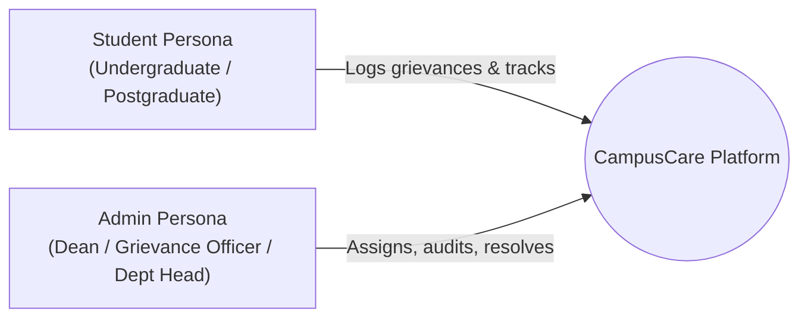
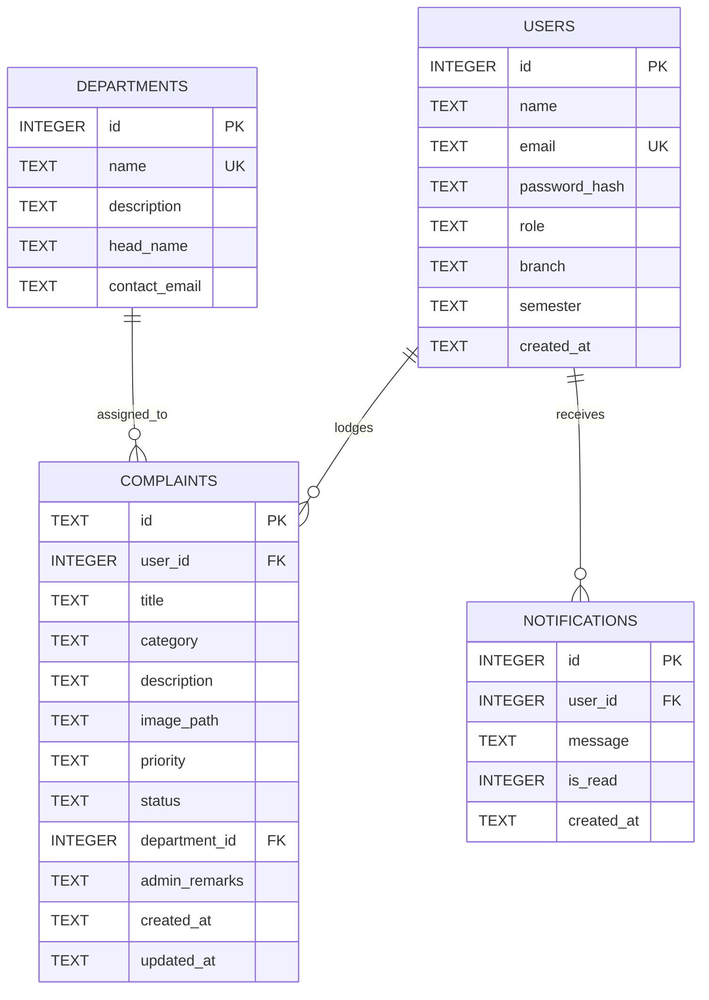
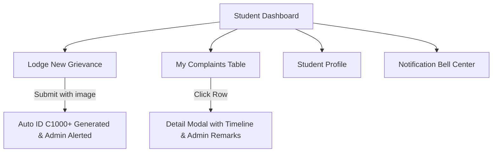
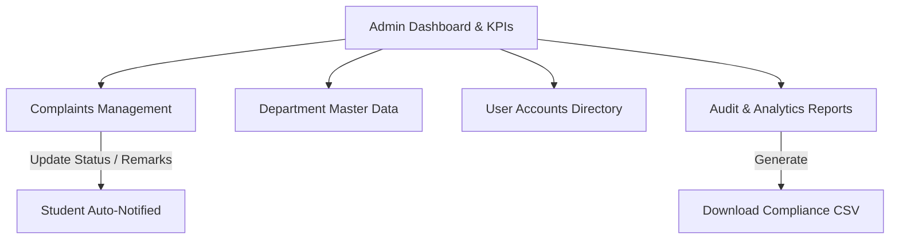

# CampusCare — Product Requirements Document (PRD)

**Project Name:** CampusCare — College Complaint & Grievance Redressal System  
**Document Version:** 1.0.0  
**Target Environment:** Node.js 24.x, React 18, Express, Native SQLite (`node:sqlite`), Vercel Multi-Service Platform  
**Live Production URL:** [https://campus-care-seven-delta.vercel.app](https://campus-care-seven-delta.vercel.app)  
**Source Repository:** [kiranraj25lk-prog/Campus-care](https://github.com/kiranraj25lk-prog/Campus-care)

---

## 1. Executive Summary & Vision

### 1.1 Problem Statement
In higher education institutions, grievance redressal and campus facility maintenance are often hindered by opaque, paper-based, or fragmented ticketing systems. Students lack visibility into ticket progress, department heads struggle with accountability, and college administration lacks centralized analytics to satisfy regulatory compliance standards (such as UGC Grievance Redressal Regulations).

### 1.2 Product Vision
**CampusCare** is a unified, transparent, and regulatory-compliant digital grievance management ecosystem. It bridges students, faculty, and administrative departments by offering:
- Fast, accessible incident lodging with image proof attachments.
- End-to-end transparent ticket lifecycle tracking (Pending &rarr; In Progress &rarr; Resolved).
- Departmental routing and accountability.
- Real-time in-app notifications and administrative analytics dashboards.
- Zero-maintenance, single-binary portable database infrastructure running serverlessly.

---

## 2. User Personas & Roles



### 2.1 Student Persona
- **Description:** Enrolled students registered with branch and semester identifiers.
- **Key Goals:**
  - Lodge grievances rapidly across multiple categories (Academic, Infrastructure, Hostel, Electrical, Labs, etc.).
  - Upload photographic evidence (equipment faults, facility breakdowns).
  - Track real-time resolution status and read administrator remarks.
  - Receive notifications when complaint statuses change.
- **Access Restrictions:** Access strictly limited to self-lodged complaints, own profile, and personal notifications.

### 2.2 Administrator / Department Head Persona
- **Description:** Designated grievance officers, administrative staff, and department chairs.
- **Key Goals:**
  - Complete visibility over institutional complaints across all departments.
  - Triage grievances, assign or reassign them to specific departments, and set priorities.
  - Update complaint statuses (Pending &rarr; In Progress &rarr; Resolved) with audit remarks.
  - Manage college department master data and department head contacts.
  - Monitor institutional KPIs, resolution clearance rates, monthly grievance trends, and export compliance CSV reports.
- **Access Restrictions:** Full administrative privileges across all records, users, and audit reports.

---

## 3. System Architecture & Tech Stack

```mermaid
graph TD
    UserClient[Web Browser / Mobile Client] -->|HTTPS Requests| VercelRouter[Vercel Edge Gateway & Routing]
    VercelRouter -->|/(.*) Frontend Pages & Assets| ReactApp[Client: React 18 + Vite + Tailwind CSS]
    VercelRouter -->|/api/(.*) REST Endpoints| ExpressAPI[Server: Express 4 API]
    VercelRouter -->|/uploads/(.*) Image Attachments| ExpressAPI
    ExpressAPI -->|Sync SQL Queries| NativeSQLite[(Embedded SQLite via Node 24 node:sqlite)]
    ExpressAPI -->|Auth & Verification| JWTAuth[bcryptjs + jsonwebtoken]
```

### 3.1 Technology Stack Details

| Layer | Technology | Version | Purpose |
| :--- | :--- | :--- | :--- |
| **Frontend Framework** | React | `18.3.1` | Component-driven Single Page Application (SPA) |
| **Build & Tooling** | Vite | `5.2.11` | Ultra-fast HMR and optimized production bundling |
| **Styling & UI** | Tailwind CSS | `3.4.3` | Utility-first responsive design, custom palettes |
| **Icons & Charts** | Lucide React + Recharts | `0.378.0` / `2.12.7` | UI icons and interactive analytics charts |
| **Routing** | React Router DOM | `6.23.1` | Client-side routing with role-based Route Guards |
| **Backend Framework**| Express | `4.19.2` | RESTful API server handling routes, auth, uploads |
| **Database Engine** | `node:sqlite` (`DatabaseSync`) | Node `24.x` | Native built-in SQLite engine (Zero native C++ build) |
| **Authentication** | JWT + bcryptjs | `9.0.2` / `2.4.3` | Stateless Bearer token sessions & salted password hashing |
| **File Uploads** | Multer | `1.4.5-lts.1` | Multipart form image processing with validation |
| **Hosting & CI/CD** | Vercel Multi-Service Platform | CLI `65.x` | Unified frontend & backend deployment with automated Git triggers |

---

## 4. Complete Database Schema



### 4.1 Schema Definitions

#### `users`
| Column | Type | Constraints | Description |
| :--- | :--- | :--- | :--- |
| `id` | `INTEGER` | `PRIMARY KEY AUTOINCREMENT` | Unique user identifier |
| `name` | `TEXT` | `NOT NULL` | Full legal name |
| `email` | `TEXT` | `UNIQUE NOT NULL` | Login email address (case-normalized) |
| `password_hash` | `TEXT` | `NOT NULL` | Salted bcrypt hash |
| `role` | `TEXT` | `NOT NULL CHECK(role IN ('student', 'admin'))` | Role-based authorization |
| `branch` | `TEXT` | `NULLABLE` | Academic department (e.g., CSE, ECE) |
| `semester` | `TEXT` | `NULLABLE` | Semester index (e.g., 4th Semester) |
| `created_at` | `TEXT` | `NOT NULL` | ISO 8601 creation timestamp |

#### `departments`
| Column | Type | Constraints | Description |
| :--- | :--- | :--- | :--- |
| `id` | `INTEGER` | `PRIMARY KEY AUTOINCREMENT` | Department ID |
| `name` | `TEXT` | `NOT NULL UNIQUE` | Official departmental name |
| `description` | `TEXT` | `NULLABLE` | Scope of responsibilities |
| `head_name` | `TEXT` | `NULLABLE` | Designated faculty / officer lead |
| `contact_email` | `TEXT` | `NULLABLE` | Official routing email |

#### `complaints`
| Column | Type | Constraints | Description |
| :--- | :--- | :--- | :--- |
| `id` | `TEXT` | `PRIMARY KEY` | Custom formatted ticket code (e.g. `C1001`) |
| `user_id` | `INTEGER` | `NOT NULL, FK -> users(id) ON DELETE CASCADE` | Student complainant |
| `title` | `TEXT` | `NOT NULL` | Concise problem title |
| `category` | `TEXT` | `NOT NULL` | Category (Hostel, Academic, Labs, etc.) |
| `description` | `TEXT` | `NOT NULL` | Detailed description of the grievance |
| `image_path` | `TEXT` | `NULLABLE` | Relative path to uploaded photographic evidence |
| `priority` | `TEXT` | `NOT NULL CHECK(priority IN ('Low', 'Medium', 'High'))` | Severity rating |
| `status` | `TEXT` | `NOT NULL CHECK(status IN ('Pending', 'In Progress', 'Resolved'))` | Current lifecycle status |
| `department_id` | `INTEGER`| `NULLABLE, FK -> departments(id) ON DELETE SET NULL` | Assigned department |
| `admin_remarks` | `TEXT` | `NULLABLE` | Notes / resolution remarks from administration |
| `created_at` | `TEXT` | `NOT NULL` | Creation timestamp |
| `updated_at` | `TEXT` | `NOT NULL` | Last modification timestamp |

#### `notifications`
| Column | Type | Constraints | Description |
| :--- | :--- | :--- | :--- |
| `id` | `INTEGER` | `PRIMARY KEY AUTOINCREMENT` | Notification identifier |
| `user_id` | `INTEGER` | `NOT NULL, FK -> users(id) ON DELETE CASCADE` | Target recipient |
| `message` | `TEXT` | `NOT NULL` | Alert message body |
| `is_read` | `INTEGER` | `NOT NULL DEFAULT 0` | Read flag (0 = unread, 1 = read) |
| `created_at` | `TEXT` | `NOT NULL` | Dispatch timestamp |

---

## 5. Functional Modules & Feature Specifications

### 5.1 Public Pages

1. **Landing Page (`/`):**
   - Modern hero section with live grievance clearance metrics.
   - 3-step redressal lifecycle explanation card deck.
   - UGC Grievance Redressal Regulation 2026 compliance badge and policy highlights.
   - Institutional category directory.
   - Quick "Demo Credentials" drawer for instant evaluator access without registration.
2. **Legal & Compliance Pages:**
   - **Privacy Policy (`/privacy`):** Explains FERPA/DPDP data protection, encrypted credentials, attachment handling, and student record retention.
   - **Terms of Service (`/terms`):** Code of conduct for grievance submissions, anti-abuse policies, and institutional SLA expectations.

### 5.2 Authentication & Authorization Module

1. **Student Registration (`/register`):**
   - Inputs: Full Name, College Email, Branch dropdown, Semester dropdown, Password (min 6 characters).
   - Form-level error validation & prevention of duplicate emails.
   - Password encrypted via `bcryptjs` (salt rounds: 10).
2. **User Login (`/login`):**
   - Inputs: Email and Password.
   - Quick-fill buttons for instant demo login (Admin, Student 1, Student 2).
   - Issues a stateless JSON Web Token (JWT) signed with `JWT_SECRET` (7-day validity).
   - Role-aware redirect: Students &rarr; `/student/dashboard`, Admins &rarr; `/admin/dashboard`.
3. **Route Guards (`PrivateRoute`):**
   - Unauthenticated visitors attempting protected routes are redirected to `/login`.
   - Role mismatches are redirected to the user's corresponding dashboard.

### 5.3 Student Portal Features



1. **Student Dashboard (`/student/dashboard`):**
   - KPI Stat cards: Total Filed, In Progress, Resolved, Pending.
   - Recent complaints table with instant status pill badges.
   - Quick action shortcuts to lodge a complaint or view notifications.
2. **Lodge New Complaint (`/student/new-complaint`):**
   - Fields: Title, Category selection, Priority selection, Department routing, In-depth problem narrative.
   - Optional file upload: Supports PNG, JPG, JPEG, WEBP (up to 5MB).
   - Automatically allocates human-readable grievance ticket IDs (`C1001`, `C1002`, etc.).
   - Dispatches confirmation notification to student and triggers admin queue updates.
3. **My Complaints (`/student/complaints`):**
   - Comprehensive searchable & filterable table of all self-lodged tickets.
   - Multi-criteria filter: Status (All, Pending, In Progress, Resolved) and text search.
   - Detail modal showing full resolution history, uploaded attachment preview, and admin remarks.
4. **Student Profile (`/student/profile`):**
   - View student identity: Name, institutional email, branch, semester, join date.
   - Editable fields: Branch, Semester, and Password update with current password validation.
5. **Notification Bell Dropdown:**
   - Accessible from top navigation across all student screens.
   - Shows badge count of unread notifications.
   - One-click "Mark as Read" or "Mark All as Read".

### 5.4 Administrator Portal Features



1. **Admin Dashboard (`/admin/dashboard`):**
   - High-level KPIs: Total Grievances, Clearance Rate (%), Active Tickets, Critical Priorities.
   - Interactive charts (Recharts):
     - **Category Distribution (Pie Chart):** Visualizes breakdown across infrastructure, academic, hostels, etc.
     - **Monthly Ticket Trends (Bar/Area Chart):** Historic grievance inflow vs. resolution velocity.
   - Recent submissions queue with direct triage action buttons.
2. **Complaints Management (`/admin/complaints`):**
   - Central repository of all complaints in the college.
   - Filter by Department, Category, Status, Priority, and keyword search.
   - Action Modal:
     - Change status (`Pending` &rarr; `In Progress` &rarr; `Resolved`).
     - Enter official `Admin Remarks` (visible to the student).
     - Reassign ticket to a different department.
     - Delete spurious or duplicate tickets with confirmation prompt.
   - Automatic dispatch of notification to the student upon status or remark update.
3. **Department Management (`/admin/departments`):**
   - Master list of college departments (Infrastructure, Academics, Hostel & Mess, IT & Labs, etc.).
   - Add new department modal (Name, Description, Lead Officer, Contact Email).
   - Edit existing department details and update designated department heads.
   - Live complaint counters per department.
4. **User Management (`/admin/users`):**
   - Directory of all registered accounts (Students and Admins).
   - Search by name, email, or academic branch.
   - Filter by user role.
   - Shows registration date, student branch, and semester enrollment.
5. **Reports & Regulatory Analytics (`/admin/reports`):**
   - Clearance rate audit per department.
   - System infrastructure verification audit badge (`Zero-setup SQLite node:sqlite`, JWT encryption).
   - **CSV Export:** Generates and downloads standard grievance report (`campuscare_grievances_report_<timestamp>.csv`) formatted for institutional board review and UGC compliance.

---

## 6. Complete API Specifications

All endpoints are prefixed with `/api`. Protected routes require `Authorization: Bearer <JWT_TOKEN>`.

### 6.1 Authentication (`/api/auth`)
- `POST /api/auth/register` — Create new student account.
- `POST /api/auth/login` — Authenticate credentials; returns `{ token, user }`.
- `GET /api/auth/me` — Return authenticated user profile.
- `PUT /api/auth/profile` — Update student profile / change password.

### 6.2 Complaints (`/api/complaints`)
- `GET /api/complaints` — List complaints (students get self tickets; admins get all tickets; supports `status`, `category`, `search` query params).
- `GET /api/complaints/:id` — Get single grievance detail with department and complainant info.
- `POST /api/complaints` — Lodge new complaint (`multipart/form-data` with `image` file, `title`, `category`, `description`, `priority`, `department_id`).
- `PATCH /api/complaints/:id/status` — Admin update for status (`Pending`/`In Progress`/`Resolved`) and remarks.
- `PATCH /api/complaints/:id/department` — Admin reassignment of department.
- `DELETE /api/complaints/:id` — Admin deletion of complaint.

### 6.3 Departments (`/api/departments`)
- `GET /api/departments` — List all departments with associated grievance counters.
- `POST /api/departments` — Admin creates new department.
- `PATCH /api/departments/:id` — Admin updates department attributes.

### 6.4 Users (`/api/users`)
- `GET /api/users` — Admin lists registered users with search and role filters.
- `GET /api/users/:id` — Admin inspects specific user profile.

### 6.5 Notifications (`/api/notifications`)
- `GET /api/notifications` — Fetch personal notifications for current user.
- `GET /api/notifications/unread-count` — Fetch unread count for badge display.
- `PATCH /api/notifications/:id/read` — Mark single notification as read.
- `PATCH /api/notifications/read-all` — Mark all user notifications as read.

### 6.6 Statistics & Health (`/api/stats`, `/api/health`)
- `GET /api/stats/overview` — Aggregated counts, clearance percentage, and category distributions.
- `GET /api/health` — Service readiness probe (`{ status: "ok", service: "CampusCare API" }`).

---

## 7. Security, Storage & Deployment Architecture

### 7.1 Security & Authentication Safeguards
- **Password Protection:** Hashes generated with `bcryptjs` using 10 salt rounds. Plaintext passwords are never persisted.
- **Session Tokens:** Stateless RFC 7519 JWTs signed with `HS256`. Token payload contains `id` and `role`.
- **RBAC:** Authorization middleware verifies valid signatures and restricts administrative endpoints from student access.
- **SQL Injection Prevention:** 100% of queries use prepared statements with parameter binding via `node:sqlite`.
- **Upload Validation:** Multer middleware validates MIME types (`image/png`, `image/jpeg`, `image/webp`) and enforces a 5MB size limit.

### 7.2 Native SQLite (`node:sqlite`) Storage Architecture
- Powered by Node 24's native `DatabaseSync` engine.
- Zero dependencies on external C++ libraries (`better-sqlite3`, `sqlite3`, or `node-gyp`), ensuring frictionless, instant build times on modern cloud platforms.
- Serverless cold-start resilience: On Vercel, if `/tmp/campuscare.sqlite` is not yet populated, the system automatically duplicates the seeded bundle from the deployment filesystem into `/tmp` and enables `WAL` mode.

### 7.3 Multi-Service Vercel Deployment Topology
- **Client Service:** Built via Vite static output, served over Vercel's global CDN edge.
- **Server Service:** Managed as an Express runtime service handling `/api/*` and file uploads via top-level path rewrites in `vercel.json`.

---

## 8. Verified Pre-Seeded Accounts

The application includes pre-seeded demo accounts for instant evaluation:

| Role | Email | Password | Academic / Dept Scope |
| :--- | :--- | :--- | :--- |
| **Administrator** | `admin@campuscare.edu` | `Admin@123` | Institutional Administration |
| **Student (Demo 1)** | `arun.kumar@campuscare.edu` | `Student@123` | Computer Science & Engineering, 6th Sem |
| **Student (Demo 2)** | `priya.sharma@campuscare.edu` | `Student@123` | Electronics & Communication, 4th Sem |
| **Student (Demo 3)** | `rahul.verma@campuscare.edu` | `Student@123` | Mechanical Engineering, 8th Sem |
